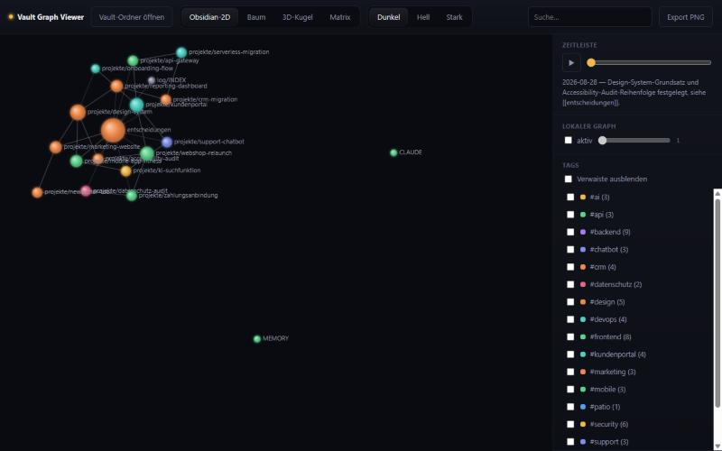
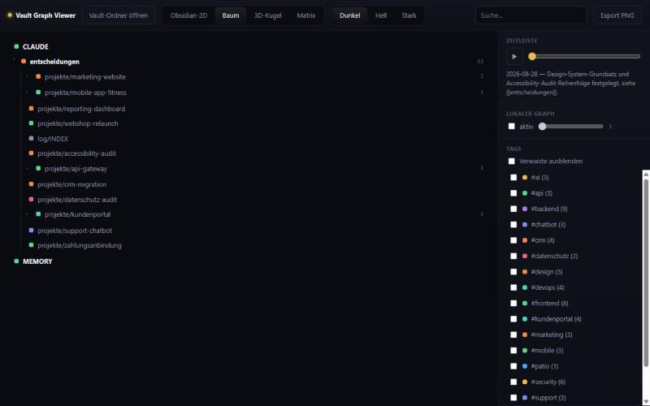
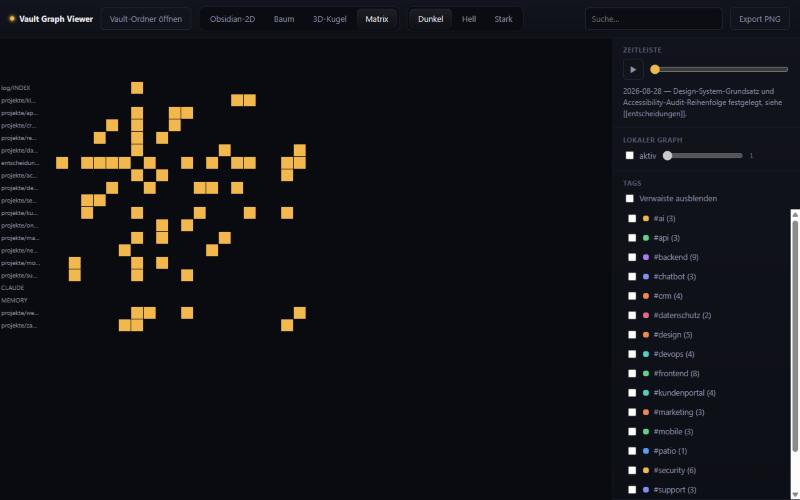
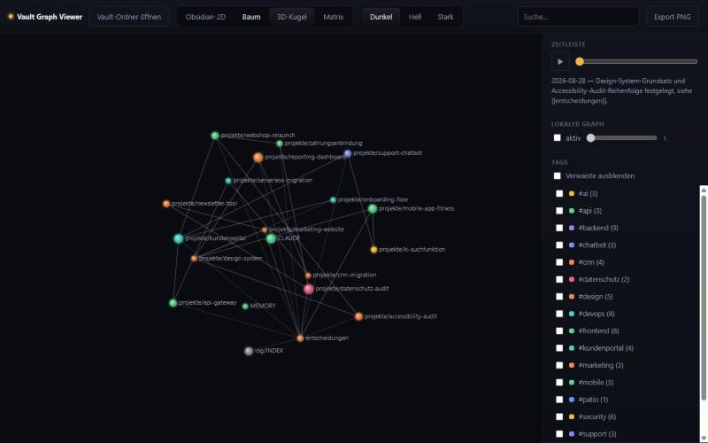
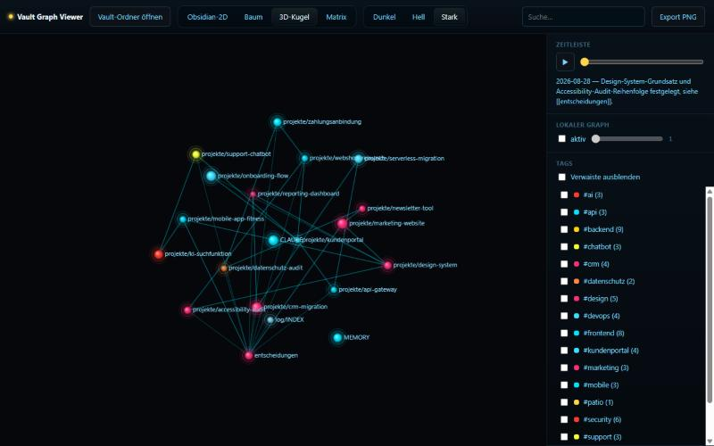

# mindvault — Dateibasiertes Gedächtnis für jedes LLM

[](https://github.com/julasim/mindvault/actions/workflows/test.yml)
[](LICENSE)

Eine portable Markdown-Vault-Struktur für die Arbeit mit beliebigen
KI-/LLM-Programmen (Claude Code, ChatGPT, Gemini, Cursor, Claude.ai-Projekte),
ergänzt um einen eigenständigen, LLM-unabhängigen Graph-Viewer — analog zu
Obsidians Graph-Ansicht, aber ohne Obsidian-Installation. Läuft komplett
offline, ohne Server, ohne LLM-Aufruf, ohne Internet.



<details>
<summary>Weitere Ansichten (Baum, 3D-Kugel, Matrix, Stark-Design)</summary>

| Baum | Matrix |
|---|---|
|  |  |

| 3D-Kugel (Dunkel) | 3D-Kugel (Stark-HUD-Design) |
|---|---|
|  |  |

</details>

Reines Desktop-Tool (Chrome/Edge empfohlen, Firefox/Safari als
Datei-Dialog-Fallback ungetestet) — auf Mobilgeräten (z.B. iOS Safari)
funktioniert es nicht, da der Browser dort keinen lokalen Ordner öffnen
kann.

## Schnellstart

1. Kopiere `vault-template/` an einen Ort deiner Wahl, z.B. `mein-gedaechtnis/`.
2. Öffne `viewer/graph-viewer.html` per Doppelklick, um deinen Vault jederzeit
   visuell zu sehen.
3. Schau dir zuerst `demo-vault/` im Viewer an, um zu sehen, wie ein befüllter
   Vault aussieht.

## Einrichtung per KI-Agent (Claude Code, Codex, ...)

Du kannst dir die manuellen Schritte oben sparen und sie direkt von deinem
KI-Coding-Agenten erledigen lassen. Füge folgenden Prompt 1:1 in Claude Code,
Codex oder ein ähnliches Tool mit Datei-/Terminalzugriff ein:

```
Richte mindvault für mich ein:

1. Klone https://github.com/julasim/mindvault in einen temporären Ordner.
2. Kopiere darin vault-template/ an einen Ort meiner Wahl (frag mich nach dem
   Zielpfad und einem passenden Namen, z.B. "Gedächtnis").
3. Lege viewer/graph-viewer.html und viewer/graph-viewer.js daneben oder in
   einen Unterordner meiner Wahl ab (die beiden Dateien müssen immer
   zusammen im selben Ordner bleiben).
4. Erkenne, in welchem Tool du gerade läufst, und richte die passende
   Plattform-Integration ein (siehe README-Abschnitt "Einrichtung je
   Plattform" im geklonten Repo) — z.B. bei Claude Code eine
   .claude/settings.json mit SessionStart-Hook, der MEMORY.md lädt; bei
   Cursor eine .cursorrules-Datei mit dem Inhalt von vault-template/CLAUDE.md.
5. Räume den temporären Klon danach auf.
6. Erkläre mir zum Schluss kurz, wo die Dateien liegen und wie ich den
   Graph-Viewer öffne.

Frag nach, wenn dir ein Zielordner oder eine Entscheidung fehlt — nichts
erfinden oder annehmen.
```

Der Agent braucht Internet- und Dateisystemzugriff (Klonen des Repos,
Dateien kopieren); alles danach läuft wie beschrieben komplett offline.

## Einrichtung je Plattform

**Claude Code:** Lege im Vault-Ordner eine `.claude/settings.json` mit
folgendem Inhalt an, damit Claude Code `MEMORY.md` bei jedem Sitzungsstart
automatisch lädt:

```json
{
  "hooks": {
    "SessionStart": [
      {
        "hooks": [
          {
            "type": "command",
            "command": "cat MEMORY.md 2>/dev/null || true"
          }
        ]
      }
    ]
  }
}
```

**ChatGPT (mit Dateizugriff/Projekte):** Lade `MEMORY.md` und die relevanten
`projekte/*.md`-Dateien als Projektwissen hoch. Nutze dafür wenn möglich ein
ChatGPT-**Projekt** (projektweite Anweisungen haben mehr Platz) und füge dort
den Inhalt von `vault-template/CLAUDE.md` ein. Ohne Projekte ist das Feld für
Custom Instructions oft zu kurz für die ganze Datei — dann reichen als
Fallback die drei Kernkonventionen (Tags, Fälligkeiten, Verknüpfungen).

**Claude.ai-Projekte:** Lade den gesamten Vault-Ordner als Projektwissen hoch,
füge `vault-template/CLAUDE.md` als Projekt-Anweisungen ein.

**Gemini (Gems):** Lege ein Gem an, füge `vault-template/CLAUDE.md` als
Anweisung ein und hänge die Vault-Dateien als Wissen an.

**Cursor:** Kopiere den Inhalt von `vault-template/CLAUDE.md` in eine
`.cursorrules`-Datei im Projektordner.

**Jedes andere Tool:** Füge `MEMORY.md` + `CLAUDE.md` am Anfang eines
Gesprächs ein, oder lade sie hoch, falls das Tool Datei-Uploads erlaubt.

## Konventionen

Siehe `vault-template/CLAUDE.md` — Tags (`#tag`), Fälligkeiten
(`Fällig: YYYY-MM-DD`), Verknüpfungen (`[[dateiname]]`).

## Graph-Viewer

`viewer/graph-viewer.html` + `viewer/graph-viewer.js` gehören zusammen —
immer im selben Ordner halten, dann komplett abhängigkeitsfrei und offline
(kein Server, kein CDN, kein Internet). Beim Öffnen wählst du deinen
Vault-Ordner über den Button „Vault-Ordner öffnen" aus (Chrome/Edge: direkte
Ordnerauswahl; Firefox/Safari: derselbe Button öffnet stattdessen einen
nativen Ordner-Auswahldialog des Betriebssystems). Vier Ansichten stehen über
die Tabs zur Verfügung: Obsidian-2D, Baum (ein-/ausklappbare Liste), 3D-Kugel
(mit Maus in alle Richtungen frei drehbar — horizontal und vertikal ziehen),
Matrix. Dazu Suche, Tag-Filter, lokaler Graph (Klick auf einen Knoten),
Zeitleiste und PNG-Export.

Drei Designs stehen oben links zur Wahl: **Dunkel** (Standard), **Hell**
(schlicht) und **Stark** (verspieltes HUD-Design). Die Wahl wird im Browser
gemerkt.

## Obsidian-Kompatibilität

Die Verknüpfungs- (`[[Link]]`) und Tag-Syntax (`#tag`) ist identisch zu
Obsidian — du kannst den Vault-Ordner zusätzlich direkt in Obsidian öffnen,
falls du es installiert hast. Ein `.obsidian`-Konfigurationsordner ist
bewusst nicht enthalten, damit nichts mit einem bestehenden Obsidian-Setup
kollidiert.

## Entwicklung

Der Viewer (`viewer/graph-viewer.html` + `viewer/graph-viewer.js`) wird aus
den Quellmodulen in `src/` + `viewer/shell.html`/`loader.js`/`render.js`
gebaut:

```bash
npm test            # node:test, läuft alle Module in src/
npm run build        # erzeugt viewer/graph-viewer.{html,js} neu
```

Node.js-Abhängigkeiten existieren ausschließlich zur Entwicklungszeit (Tests,
Build) — das Ausliefer-Artefakt selbst ist zwei abhängigkeitsfreie Dateien.

## Weitere Dokumentation

- [docs/ANLEITUNG.md](docs/ANLEITUNG.md) — ausführliche, nicht-technische
  Anleitung für Nutzer ohne Programmiervorkenntnisse.
- [docs/LLM-ANLEITUNG.md](docs/LLM-ANLEITUNG.md) — ausführliche
  Pflegeanleitung für KI-Assistenten (Grundlage für `vault-template/CLAUDE.md`,
  auch als Referenz für eigene Skills/Implementierungen).

## Lizenz

MIT — siehe [LICENSE](LICENSE).
